# Field Service Tracker

**Offline-first field service and maintenance management application built
with Flutter, BLoC and SQLite.**

> 🚧 **Work in progress — Phase 8 of 9 (quality assurance & polish).**
> All features of the first version are in place and tested: dashboard,
> customers, devices, maintenance records, maintenance overview and
> settings with demo data reset. Quality assurance / CI and the portfolio
> release follow; see the [roadmap](#roadmap).

## Project Overview

Field Service Tracker helps water-purifier and similar field-service
businesses track customers, their devices and periodic maintenance — fully
offline, with all data stored on the device. The UI is in Turkish.

## Features

| Feature | Status |
|---|---|
| Material 3 app shell with 4-tab navigation | ✅ |
| "Calm Operations" design system (Inter, tokens, status colors) | ✅ |
| Settings: app identity, real version, about, open-source licenses | ✅ |
| Local SQLite database (Drift) with integrity constraints | ✅ |
| Fictional demo data on first launch; confirmed, transactional "reset demo data" in Settings | ✅ |
| Maintenance status rules (overdue / upcoming / scheduled) | ✅ (logic, UI ⏳) |
| Customers: live Turkish-aware search, create, edit, safe delete with impact preview | ✅ |
| Customer detail with devices and maintenance status | ✅ |
| Devices: add, edit, safe delete (with maintenance history impact) | ✅ |
| Device detail: status, days until/over due, read-only maintenance history | ✅ |
| Unsaved-changes protection on all forms | ✅ |
| Maintenance records: dates (6-month suggestion), filter replacements, Turkish lira price, notes | ✅ |
| Dashboard: customers, devices, overdue and upcoming KPIs, priority list | ✅ |
| Maintenance overview with status filters and priority ordering | ✅ |
| Statuses refresh when the calendar day changes (resume / midnight) | ✅ |

## Screenshots

Real screenshots from the Android emulator (demo data):

| Dashboard | Maintenance overview | Overdue filter |
|---|---|---|
| 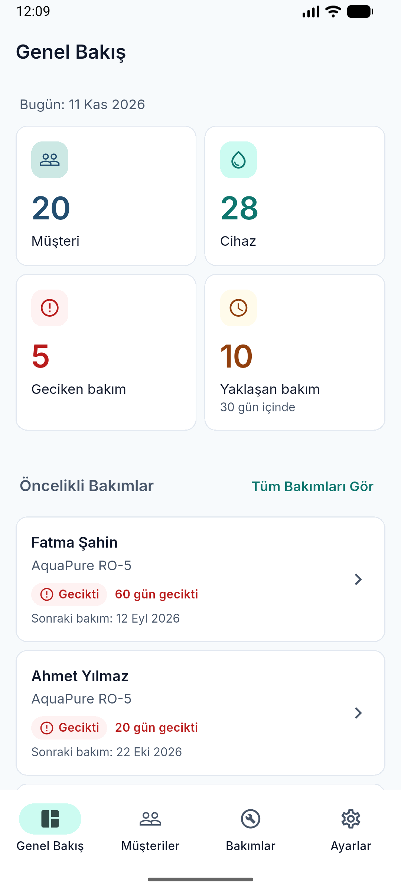 | 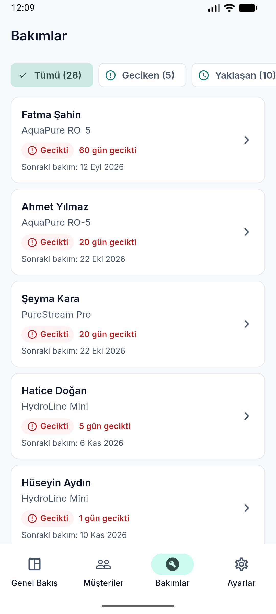 | 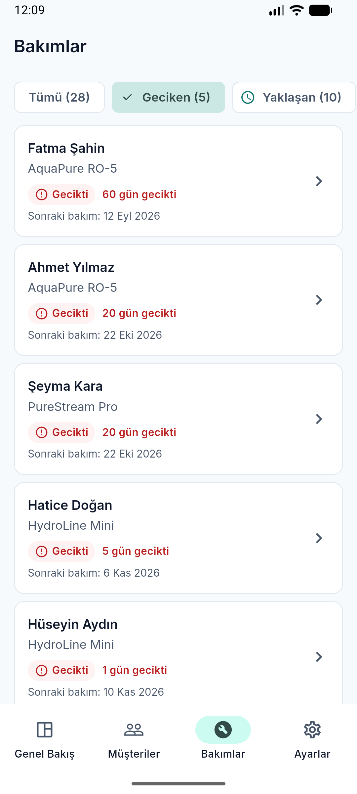 |


| Customer detail | Device detail | Maintenance history |
|---|---|---|
| 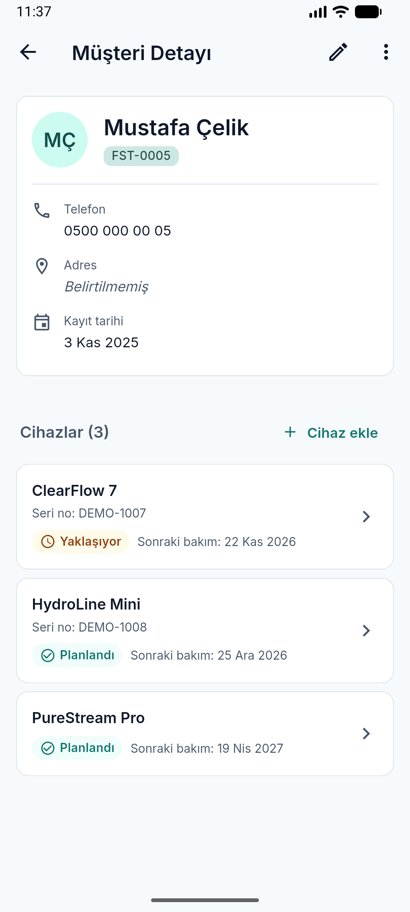 | 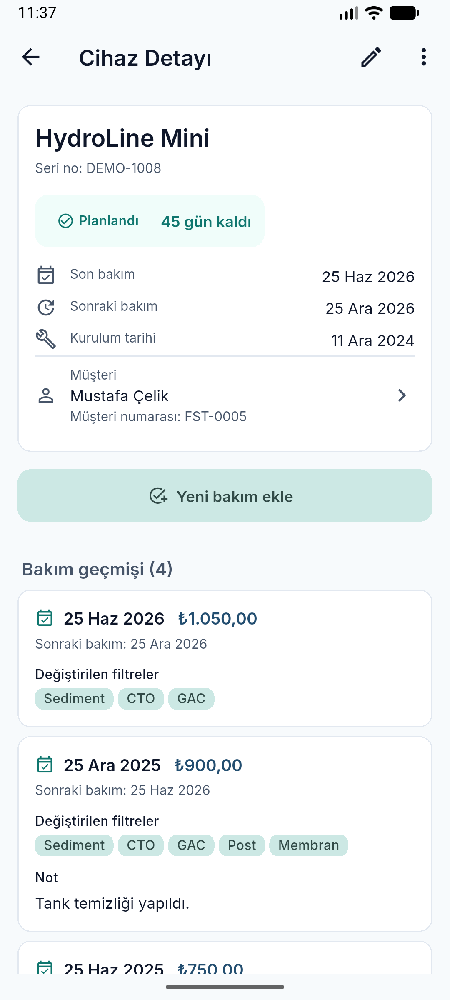 | 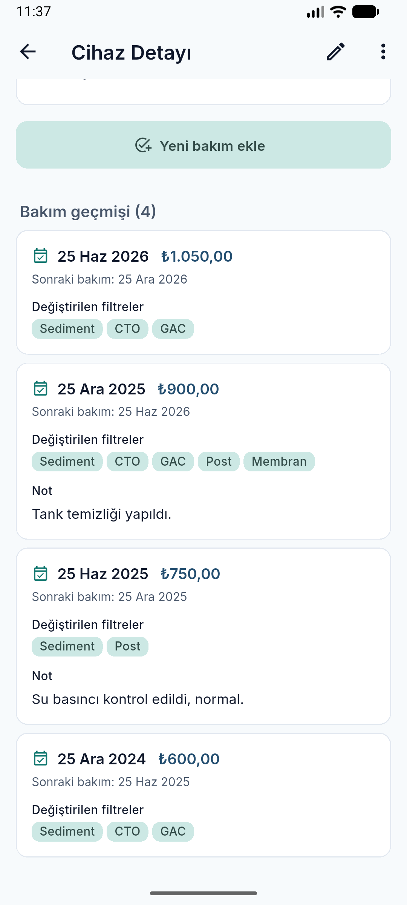 |

| New device (Turkish date picker) | Delete confirmation | Unsaved changes |
|---|---|---|
| 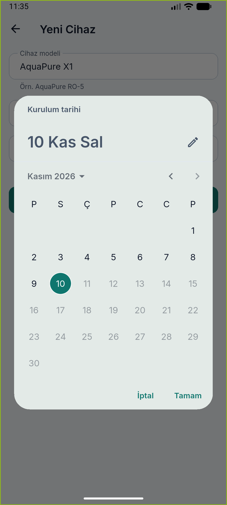 | 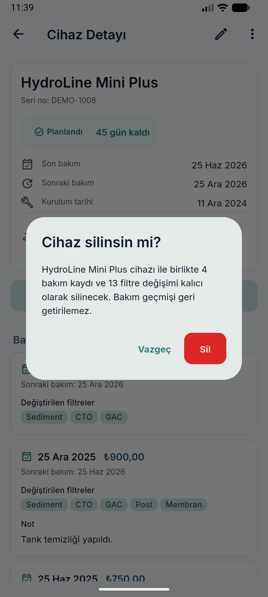 | 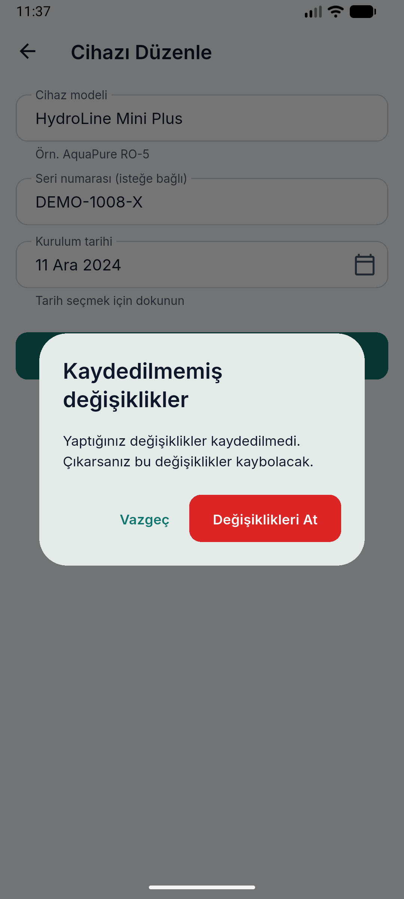 |

| New maintenance | Filter selection & price | History after saving |
|---|---|---|
| 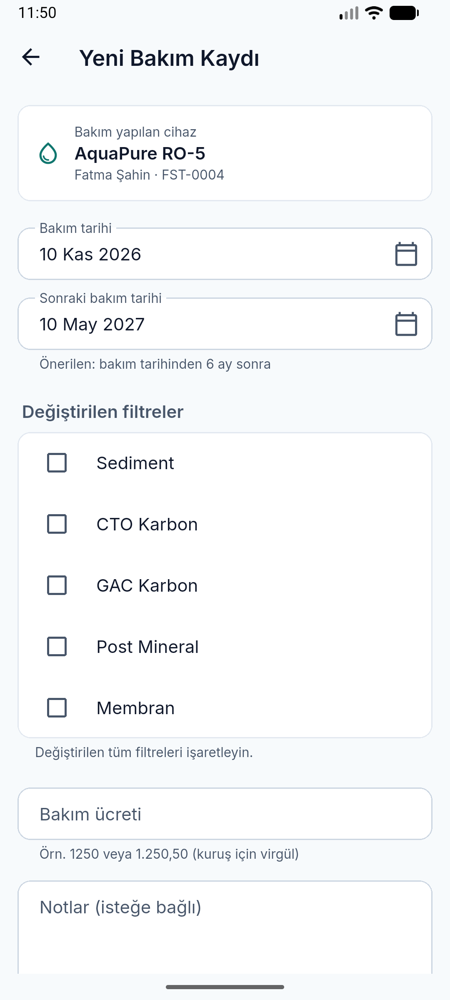 | 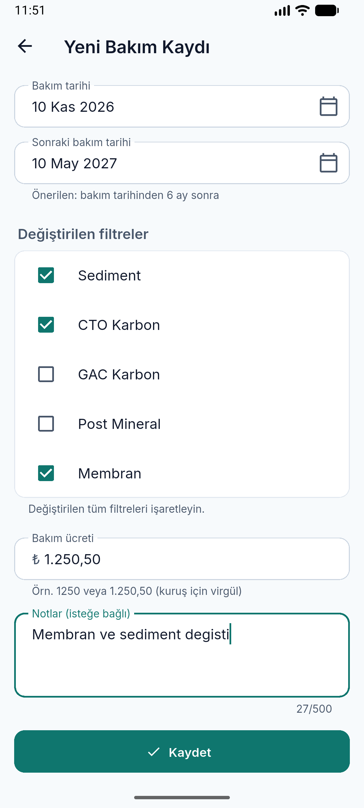 | 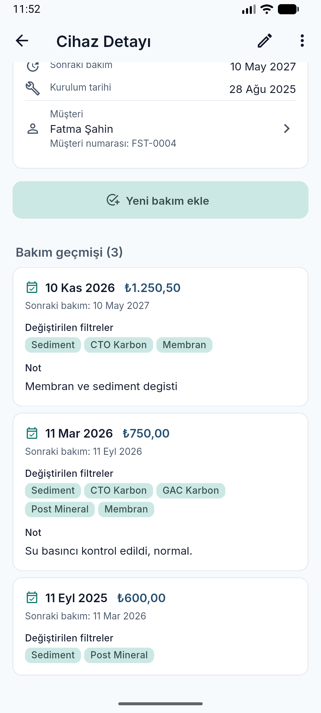 |

| Settings | Reset confirmation | After reset |
|---|---|---|
| 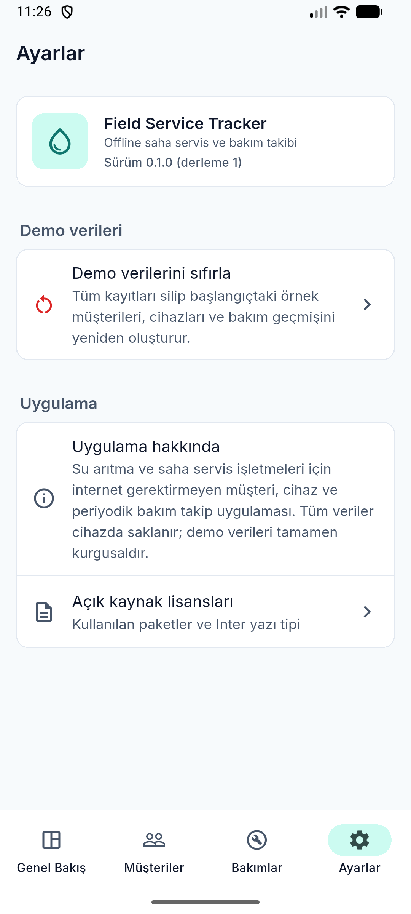 | 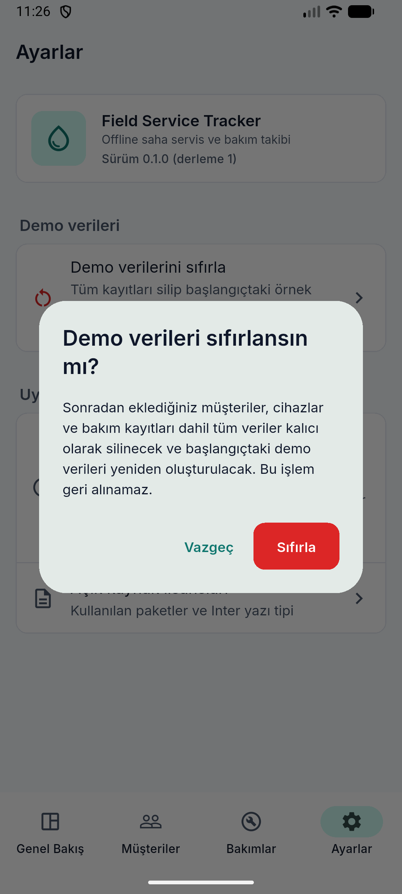 | 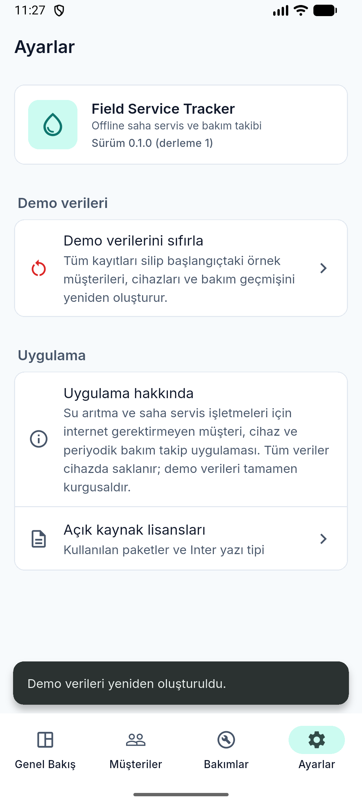 |

More in [`docs/images/`](docs/images/).

## Demo Video

_Planned for the portfolio release (Phase 9)._

## Architecture

Feature-first layered architecture:

```
UI → Cubit → Repository interface → Repository implementation → DAO → SQLite
```

Details: [docs/ARCHITECTURE.md](docs/ARCHITECTURE.md).

## Tech Stack

| Area | Technology |
|---|---|
| Framework | Flutter 3.47 · Dart 3.13 |
| UI | Material 3 (`material_ui`) |
| State management | `flutter_bloc` (Cubit) + `equatable` |
| Navigation | `go_router` (`StatefulShellRoute`) |
| Database | Drift + SQLite (`drift_flutter`) |
| Localization | gen-l10n (Turkish) + `intl` |
| Testing | `flutter_test`, `bloc_test`, `mocktail` |

## Database Design

Four related tables — customers → devices → maintenance records → filter
replacements — with foreign keys (`RESTRICT`), unique and check constraints.
Details: [docs/DATABASE.md](docs/DATABASE.md).

## Project Structure

```
lib/
  app/        app widget, router, theme
  core/       clock, extensions, shared widgets
  l10n/       Turkish strings (ARB)
  database/   Drift database, tables, DAOs, seed
  features/   dashboard, customers, devices, maintenance, settings
docs/         architecture, database, design system, features, testing
```

## Getting Started

Requirements: Flutter 3.47+ (stable), Android SDK, an emulator or device.

```bash
flutter pub get
flutter run
```

## Testing

```bash
dart format .
flutter analyze
flutter test
```

More: [docs/TESTING.md](docs/TESTING.md).

## Design System

See [docs/DESIGN_SYSTEM.md](docs/DESIGN_SYSTEM.md).

## Roadmap

1. ✅ Project foundation — theme, routing, DI, docs
2. ✅ Database & domain — Drift schema, DAOs, repositories, rules, seed
3. ✅ Customers — list, search, form, detail, safe delete
4. ✅ Devices — add, edit, detail with history, safe delete
5. ✅ Maintenance — record visits with filters, price, notes and next date
6. ✅ Dashboard & maintenance overview
7. ✅ Settings & demo data management
8. ✅ Quality assurance & UX polish — code / UX review, 2× text check on the
   emulator, navigation and price-input fixes
9. ⏳ Portfolio release — CI workflow, demo video, release APK, public
   showcase repository

## Known limitations

- Single device, offline only: no cloud sync, backup or multi-user access.
- Maintenance records are immutable in v1 (no edit / delete); deleting a
  device or customer removes its history after confirmation.
- Turkish UI only; light theme only.
- Verified on an Android emulator (API 37); not yet on physical devices or
  iOS.
- No automated CI yet (planned for the portfolio release).

## Disclaimer

This is an independent portfolio project. It is not affiliated with any
company and contains no real customer data; all demo data is fictional.
The Inter typeface is licensed under the SIL Open Font License 1.1
(`assets/fonts/inter/OFL.txt`).
