# Field Service Tracker

**Offline-first customer, device and maintenance management for field
service teams — built with Flutter, BLoC (Cubit) and Drift/SQLite.**

Field Service Tracker helps small field-service businesses such as
water-purifier services keep track of their customers, the devices installed
at each customer and the periodic maintenance those devices need. All data
lives in a local SQLite database on the phone; the app works without a
network connection and has no backend.

> **Note:** the user interface is in **Turkish** (the target market). Code,
> comments and documentation are in English. All data shown in screenshots
> and the demo video is fictional.

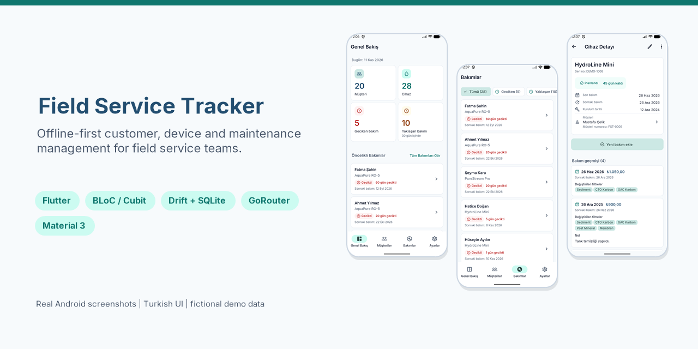

[](https://github.com/MazlumErk/field-service-tracker/actions/workflows/ci.yml)

## Key Features

- **Dashboard** — customer and device counts, overdue and upcoming
  (≤ 30 days) maintenance KPIs, and a priority list of the most urgent
  devices.
- **Customers** — live, Turkish-aware search (`sahin` finds *Şahin*),
  Turkish alphabetical sorting, create / edit with inline validation and a
  unique customer number, safe delete that first shows how many devices and
  maintenance records will be removed.
- **Devices** — add, edit and delete devices per customer; device detail
  shows the maintenance status in plain language ("60 gün gecikti" — 60 days
  overdue) and the full maintenance history.
- **Maintenance records** — maintenance date, next date (suggested 6 months
  later, editable), replaced filters (Sediment, CTO Karbon, GAC Karbon, Post
  Mineral, Membran), price in Turkish lira (`1.250,50` or `1250.50`) and
  notes.
- **Maintenance overview** — every device with its status, filterable by
  *Tümü / Geciken / Yaklaşan / Planlanan / Bakım Kaydı Yok* and ordered by
  priority.
- **Automatic status refresh** — statuses are recalculated when the calendar
  day changes (app resumed or midnight), without any data change.
- **Unsaved-changes protection** on all forms, double-submit guards and
  confirmation dialogs for destructive actions.
- **Settings** — app version, open-source licenses and a confirmed,
  transactional "reset demo data" action.
- **Accessibility** — status is never shown by color alone (icon + label),
  48 dp touch targets, layouts verified at 2× system font size.

## Screenshots

Real screenshots from an Android emulator (API 37, 1080 × 2400, fictional
demo data):

| Dashboard | Customers | Customer detail | Device detail |
|---|---|---|---|
| 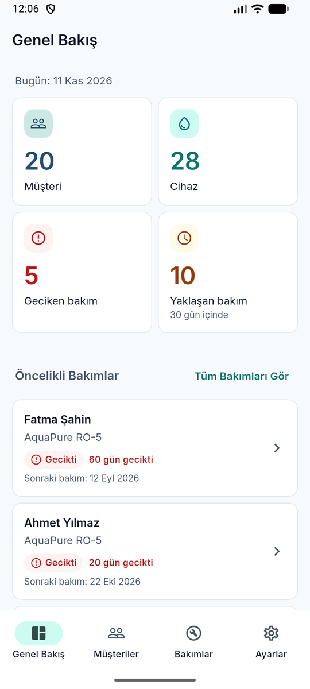 | 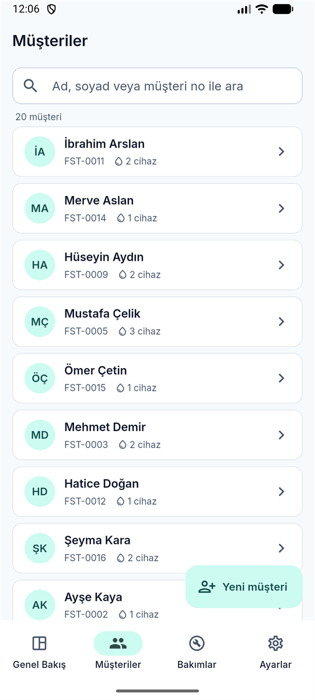 | 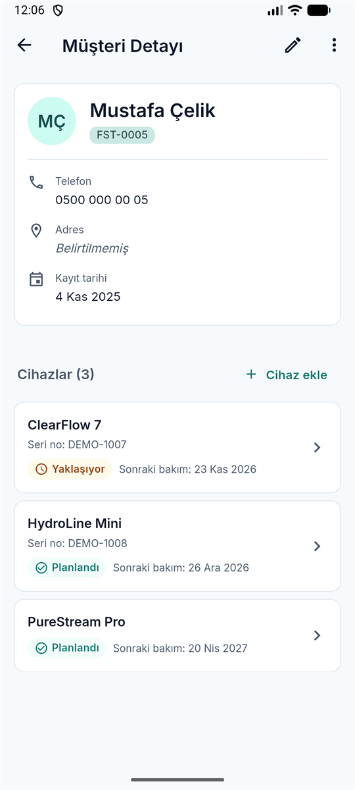 | 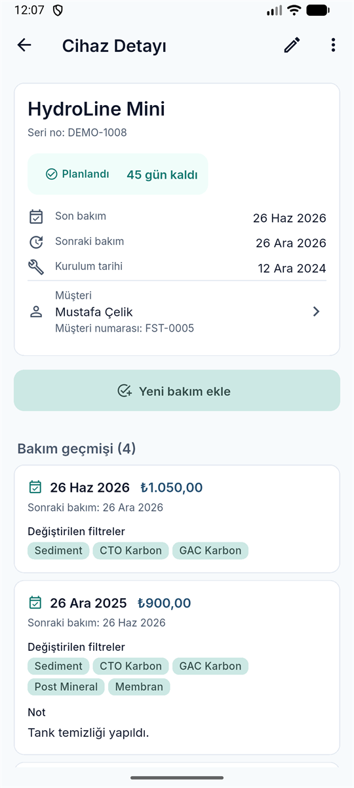 |

| Maintenance history | Maintenance form | Maintenance overview | Settings |
|---|---|---|---|
| 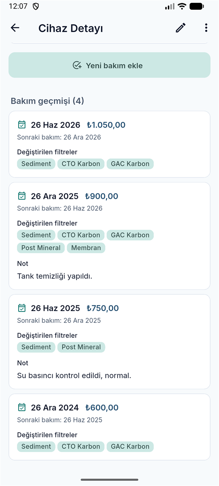 | 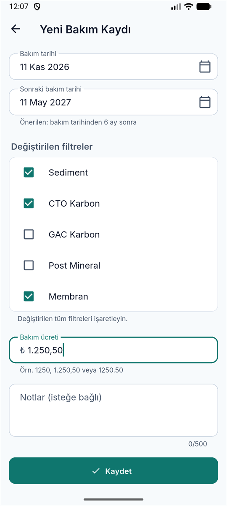 | 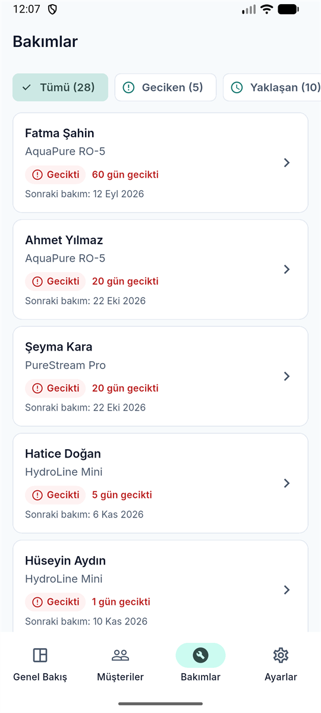 | 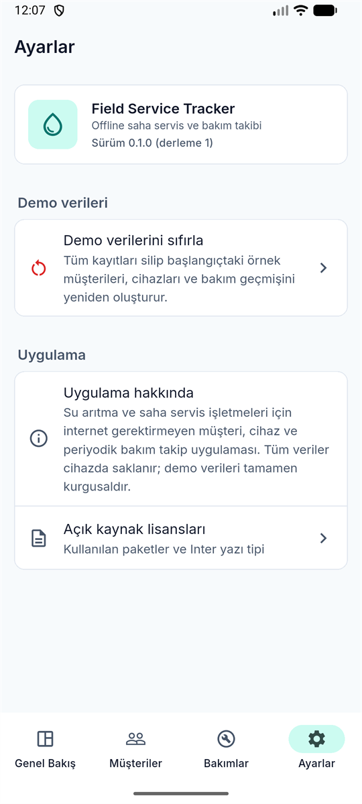 |

| Validation errors | Delete confirmation | Unsaved changes |
|---|---|---|
| 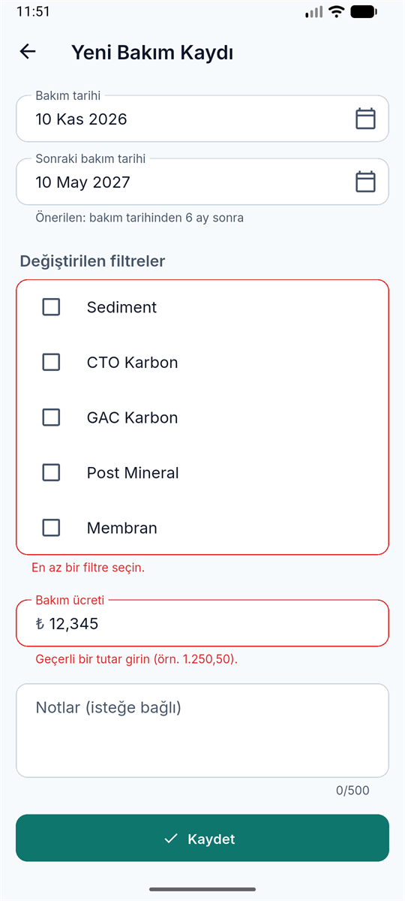 | 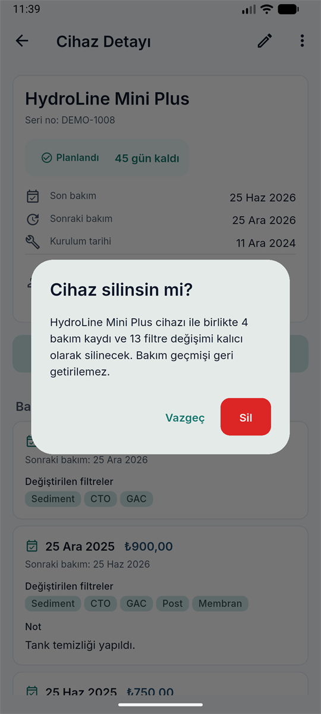 | 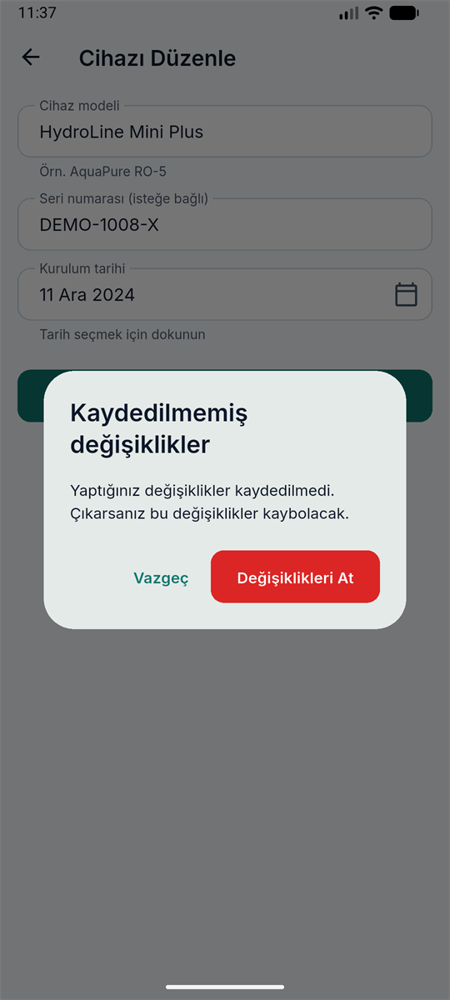 |

### Demo video

[**Watch the 64-second demo (MP4, 3.8 MB)**](docs/media/demo.mp4) — recorded
on the Android emulator: dashboard → Turkish-insensitive customer search →
customer and device detail → new maintenance record → dashboard update
(overdue 5 → 4) → maintenance filters → demo data reset.

## Tech Stack

| Area | Technology |
|---|---|
| Framework | Flutter 3.47.9 (stable) · Dart 3.13 |
| UI | Material 3 via the `material_ui` package, bundled Inter font |
| State management | `flutter_bloc` 9 (Cubit) + `equatable` |
| Navigation | `go_router` 18 (`StatefulShellRoute.indexedStack`) |
| Persistence | Drift 2.35 + SQLite (`drift_flutter`) |
| Localization | Flutter gen-l10n (Turkish ARB) + `intl` |
| Testing | `flutter_test`, `bloc_test`, `mocktail`, in-memory Drift |
| CI | GitHub Actions (format, analyze, test) |
| Platform | Android (the only configured platform) |

Why these choices: see [docs/ARCHITECTURE.md](docs/ARCHITECTURE.md#technology-choices).

## Architecture Overview

Feature-first, layered architecture. Each feature (`customers`, `devices`,
`maintenance`, `dashboard`, `settings`) has its own `domain`, `data` and
`presentation` folders as needed; shared code lives in `core` and
`database`.

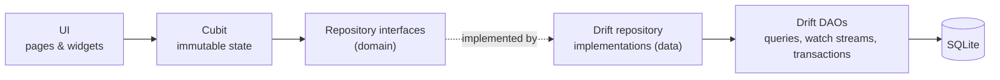

- Cubits depend only on repository **interfaces** and an injectable clock,
  so they are unit-tested with mocks.
- DAOs expose Drift `watch()` streams; saving a record updates every open
  screen (dashboard, lists, detail) without manual refresh.
- Business rules (status calculation, validation, price parsing, scheduling)
  are pure Dart domain classes shared by all screens.

```
lib/
  app/        app widget, router, theme, dependency wiring
  core/       clock, errors, validation, Turkish text utils, shared widgets
  database/   Drift database, tables, DAOs, demo seeder
  features/   customers, devices, maintenance, dashboard, settings
  l10n/       Turkish strings (ARB) + generated localizations
```

More: [docs/ARCHITECTURE.md](docs/ARCHITECTURE.md).

## Data Model

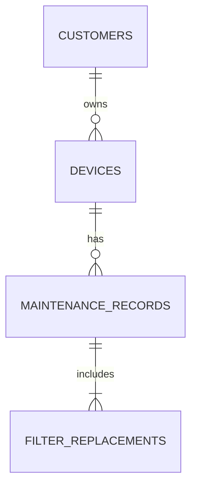

| Table | Key columns |
|---|---|
| `customers` | unique normalized customer number, name, optional phone / address, Turkish-folded `search_key` |
| `devices` | customer FK, model, optional serial number, installation date |
| `maintenance_records` | device FK, maintenance date, next maintenance date, price in kuruş (integer), notes |
| `filter_replacements` | record FK, filter type — unique per record |

Dates without a time are stored as ISO `yyyy-MM-dd` text, money as integer
kuruş (no floating point). Details: [docs/DATABASE.md](docs/DATABASE.md).

## Offline-First Approach

- The database is the single source of truth; there is no server, account
  or network call in the app.
- Data survives app restarts; demo data is created **only on the first
  launch** (when the database file is created) and never overwrites user
  data afterwards.
- The Inter font is bundled, so the UI looks the same without internet.
- There is **no cloud sync or backup** — uninstalling the app deletes its
  data. This is a deliberate scope limit (see
  [Known Limitations](#known-limitations)).

## Maintenance Scheduling Logic

`days = nextMaintenanceDate − today`, counted in calendar days:

| Condition | Status (UI label) |
|---|---|
| `days < 0` | Overdue (*Gecikti*) |
| `0 ≤ days ≤ 30` | Upcoming, includes today (*Yaklaşıyor*) |
| `days > 30` | Scheduled (*Planlandı*) |
| no maintenance record | *Bakım Kaydı Yok* |

- The next date defaults to **maintenance date + 6 calendar months**; if the
  target month is shorter, the day is clamped (Aug 31 → Feb 28/29). The user
  may pick any date on or after the maintenance date.
- A device's status comes from its **latest** record (ties on the same day
  are resolved deterministically: the record saved later wins).
- Dashboard and overview share one rule class and one SQL overview query, so
  their numbers always agree.
- A `DayTracker` re-evaluates statuses when the app resumes on a new day and
  at local midnight (one timer, DST-safe).

## Reliability & Data Integrity

- **Foreign keys enforced** (`PRAGMA foreign_keys = ON`, checked at startup)
  with `ON DELETE RESTRICT`; deleting a customer or device first shows the
  impact, then deletes children explicitly **in one transaction**.
- **Transactions with rollback:** a maintenance record and its filters, a
  cascade delete and the demo-data reset are atomic; tests inject a failing
  SQLite trigger mid-transaction and assert nothing partial remains.
- **Validation twice:** in the form (inline Turkish messages) and again in
  the repository before writing. `CHECK` constraints guard the schema
  (non-blank names, price ≥ 0, next date ≥ maintenance date).
- **Unambiguous money input:** `1.250,50`, `1250,50` and `1250.50` are
  accepted; ambiguous input such as `1.250.50` is rejected, never guessed.
- **Calendar-safe dates:** a date-only value object avoids timezone / DST
  day shifts.
- **Errors:** database exceptions are mapped to typed app exceptions; users
  see friendly Turkish messages, never raw exception text.
- **Lifecycle hygiene:** every Cubit cancels its stream subscriptions and
  timers in `close()` (covered by tests).

## Testing & QA

```bash
dart format --set-exit-if-changed .
```

```bash
flutter analyze
```

```bash
flutter test
```

- **318 tests**: domain rules (date and status boundaries, price parsing,
  validation), database constraints and schema snapshot, repositories
  (in-memory SQLite, transactions, rollback, streams), Cubits (`bloc_test`,
  `mocktail`) and seeded end-to-end widget flows (including 2× text size).
- The tests favour business rules and data integrity over coverage numbers.
- **CI:** [GitHub Actions](.github/workflows/ci.yml) runs code generation
  and verifies generated files, formatting, `flutter analyze` and
  `flutter test` on every push and pull request to `main` (read-only token,
  no secrets).
- Manual QA on the Android emulator: all flows, 2× font scale, fresh
  install, demo reset. See [docs/TESTING.md](docs/TESTING.md).

## Getting Started

Requirements:

- Flutter **3.47.9** (stable channel) with Dart 3.13
- Android SDK (e.g. via Android Studio) and an Android emulator or device
- Git

Check your setup:

```bash
flutter doctor
```

## Installation

```bash
git clone https://github.com/MazlumErk/field-service-tracker.git
```

```bash
cd field-service-tracker
```

```bash
flutter pub get
```

Generated code (Drift `*.g.dart`, `lib/l10n/app_localizations*.dart`) is
committed; `flutter pub get` refreshes the localizations. Regenerate the
Drift code only after changing tables or DAOs:

```bash
dart run build_runner build
```

## Running

Start an emulator (or connect a device), then:

```bash
flutter run
```

Build an APK for local testing:

```bash
flutter build apk --release
```

Without a release keystore this APK is signed with the **debug key** and is
for testing only. Release signing setup: [docs/RELEASE.md](docs/RELEASE.md).

## Demo Data

On the first launch the app creates fictional demo data:

- 20 customers (`FST-0001` … `FST-0020`, phone numbers `0500 000 00 xx`),
  28 devices, 63 maintenance records and 210 filter replacements;
- next maintenance dates relative to **today**, so every status is visible
  (overdue, due today, upcoming within 7 / 30 days, scheduled, never
  serviced).

**Ayarlar → Demo verilerini sıfırla** deletes all data (including your own
entries) after a confirmation and recreates the demo data in one
transaction.

## Known Limitations

- **Single device, offline only:** no user accounts, cloud sync, backup /
  export or multi-user access.
- Maintenance records cannot be edited or deleted individually in this
  version (deleting a device or customer removes its history after
  confirmation).
- Turkish UI only; light theme only.
- Android only; tested on an emulator (API 37), not yet on physical devices.
  No iOS project is configured.
- No published release build yet; release signing is prepared but requires
  the owner's keystore ([docs/RELEASE.md](docs/RELEASE.md)).

## Project Status

Version `0.1.0` — feature-complete first version, developed in nine
documented phases (foundation → database → customers → devices →
maintenance → dashboard → settings → QA → portfolio preparation).
Feature list and acceptance criteria: [docs/FEATURES.md](docs/FEATURES.md).

**License:** not chosen yet — until a license file is added, all rights are
reserved. The bundled Inter typeface is licensed under the SIL Open Font
License 1.1 ([`assets/fonts/inter/OFL.txt`](assets/fonts/inter/OFL.txt)).

This is an independent portfolio project, not affiliated with any company,
and it contains no real customer data.

## Author / Contact

**Mazlum Erkek** — Flutter developer

- GitHub: [@MazlumErk](https://github.com/MazlumErk)
