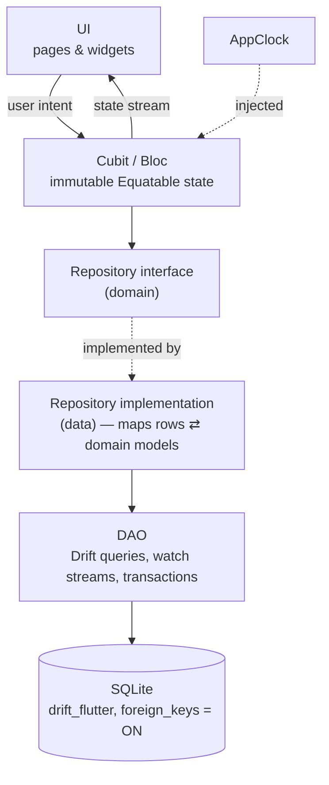
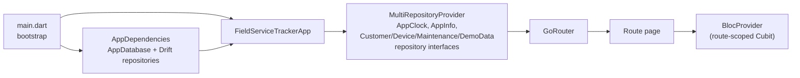

# Architecture

> Status: **Phase 2** — app shell, theme, routing, dependency wiring, the
> database, domain rules and repositories are implemented. Screens are
> planned (marked *planned*).
> Rules are defined in [AGENTS.md](../AGENTS.md); this document explains them.

## Layers and data flow

- **Reactive updates:** DAOs expose Drift `watch()` streams; repositories map
  them to domain models. `MaintenanceRepository.watchOverview()` returns every
  device with its customer and latest maintenance dates (one SQL query with a
  correlated sub-query). Saving a record re-triggers it, so dashboard and
  lists will update without manual refresh.
- **Status calculation** (`MaintenanceStatusCalculator`) is a pure domain
  function. Overviews store dates only; Cubits call `statusOn(today)` with
  `CalendarDate.today(clock)`, so the status is always correct for the
  current day even if no data changed.
- **Stream lifetime:** Drift watch streams are lazy; they stop when the last
  listener cancels (Cubits cancel in `close()`). `AppDependencies.dispose()`
  closes the database when the root widget is disposed.

## Domain building blocks

| Area | Classes |
|---|---|
| Core | `CalendarDate` (date-only value object), `TurkishText`, `AppClock`, `ValidationResult`, `AppException` hierarchy |
| Customers | `Customer`, `CustomerListItem`, `CustomerDraft`, `CustomerDeletionImpact`, `CustomerNumber`, `CustomerValidator`, `CustomerRepository` |
| Devices | `Device`, `DeviceDraft`, `DeviceValidator`, `DeviceRepository` |
| Maintenance | `MaintenanceRecord`, `MaintenanceRecordDraft`, `FilterType`, `MaintenanceStatus` + `MaintenanceStatusCalculator`, `MaintenanceSchedule`, `MaintenancePrice`, `MaintenanceValidator`, `DeviceMaintenanceOverview`, `MaintenanceRepository` |
| Settings | `DemoDataRepository` |

Repositories validate drafts again before writing (defence in depth) and
throw only `AppException` subtypes: `NotFoundException`,
`ValidationException`, `DuplicateCustomerNumberException`,
`ConstraintViolationException`, `DatabaseException`.

## Dependency injection

Cubits are created per route and closed automatically when the route is
popped. Repositories and the database are app-wide singletons.

## Navigation

| Path | Screen | Navigator |
|---|---|---|
| `/dashboard` | Genel Bakış | tab 1 |
| `/customers` | Müşteriler | tab 2 |
| `/customers/new` | Yeni Müşteri | root |
| `/customers/:id` | Müşteri Detayı | root |
| `/customers/:id/edit` | Müşteriyi Düzenle | root |
| `/customers/:id/devices/new` | Yeni Cihaz | root |
| `/maintenance` | Bakımlar | tab 3 |
| `/settings` | Ayarlar | tab 4 |
| `/devices/:id` | Cihaz Detayı | root |
| `/devices/:id/edit` | Cihazı Düzenle | root |
| `/devices/:id/maintenance/new` | Yeni Bakım Kaydı | root |

- The four tabs use `StatefulShellRoute.indexedStack`; each tab keeps its
  scroll position and stack.
- Detail and form pages are pushed on the **root** navigator: they cover the
  bottom bar, and the Android back button pops them back to the tab.
- Unknown paths and malformed ids (`/customers/abc`) render `NotFoundPage`.

## Key decisions

| Decision | Reason |
|---|---|
| `material_ui` package instead of `flutter/material.dart` | Material was decoupled from the framework (Flutter 3.44+); `go_router` 18 uses it. One Material library avoids duplicate `ThemeData` types. |
| Cubit over Bloc | Screens have simple intent → state flows; no event transformers needed yet. |
| No use-case layer for CRUD | Avoids pass-through classes; domain services only for real rules. |
| Bundled Inter font | Offline-first: no runtime font download. |
| gen-l10n with a single `tr` ARB | Official tooling, compile-time checked strings, ready for more locales. |
| Date-only `CalendarDate` for maintenance dates | Prevents timezone / DST day shifts; ISO text sorts correctly in SQL. |
| `ON DELETE RESTRICT` + explicit transactional cascade | The schema blocks accidental bulk deletes; the user confirms counts first. |
| Seeder runs in `beforeOpen` when `wasCreated` | Exactly once per install, with foreign keys already enforced; no "seeded" flag table. |
| Turkish-folded `search_key` column | SQLite `LIKE` folds ASCII only. |
| Database ↔ DAO import cycle | Standard Drift pattern (`part` files); no other cycles exist. |
