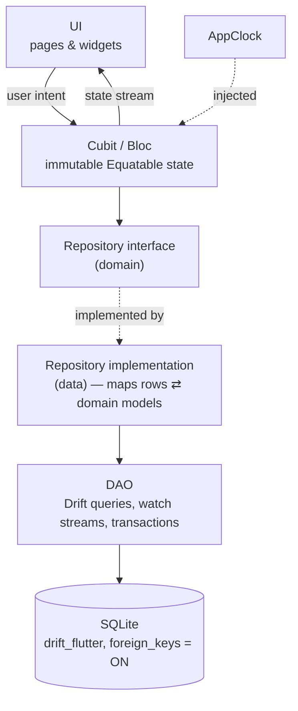
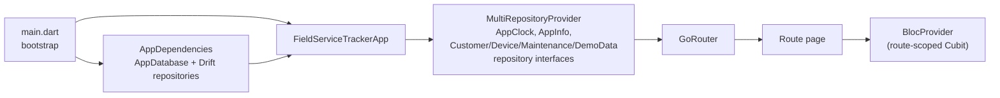

# Architecture

> Status: **v0.1.0, feature-complete** — dashboard, customers (with devices
> and maintenance records), maintenance overview and settings with demo data
> reset.
> Rules are defined in [AGENTS.md](../AGENTS.md); this document explains them.

## Layers and data flow

- **Reactive updates:** DAOs expose Drift `watch()` streams; repositories map
  them to domain models. `MaintenanceRepository.watchOverview()` returns every
  device with its customer and latest maintenance dates (one SQL query with a
  correlated sub-query). Saving a record re-triggers it, so dashboard and
  lists will update without manual refresh.
- **Status calculation** (`MaintenanceStatusCalculator`) is a pure domain
  function. Overviews store dates only; Cubits call `statusOn(today)` with
  `CalendarDate.today(clock)`, so the status is always correct for the
  current day even if no data changed.
- **Shared overview rules:** `MaintenanceOverviewRules` (domain) counts and
  orders overviews for both the dashboard and the maintenance list; no
  screen implements its own status logic. Both screens listen to the same
  `watchOverview()` query (one SQL statement, latest record via a
  correlated sub-query) — no N+1 queries.
- **Day changes:** `DayTracker` implements `TodayProvider`
  (`today` + `changes` stream). It is created by the root widget, checks the
  clock on `AppLifecycleState.resumed` and arms a single timer for just
  after the next local midnight. Dashboard, maintenance list, customer
  detail and device detail recompute statuses when it emits.
- **Stream lifetime:** Drift watch streams are lazy; they stop when the last
  listener cancels (Cubits cancel in `close()`). `AppDependencies.dispose()`
  closes the database when the root widget is disposed.

## Cubits (presentation logic)

All Cubits depend only on domain repository interfaces (plus `AppClock`),
are created per route with `BlocProvider`, and use a **single immutable
state class with a status enum** (equatable 3 does not compare runtime
types, so state subclasses with equal props would be equal).

| Cubit | Responsibility | Repository calls |
|---|---|---|
| `CustomerListCubit` | Live list + debounced search (250 ms); one subscription at a time, the previous query stream is cancelled; `resultsQuery` keeps counts and empty states consistent while debouncing | `watchCustomers(query)` |
| `CustomerDetailCubit` | Combines customer + device-overview streams; delete flow `idle → loadingImpact → confirming → deleting → deleted` | `watchCustomer`, `watchCustomerOverview`, `getDeletionImpact`, `deleteCustomer` |
| `CustomerFormCubit` | Create / edit (`.create` / `.edit`); domain validation before saving; maps `DuplicateCustomerNumberException` to an inline field error; ignores submits unless in `editing` | `getCustomer`, `createCustomer`, `updateCustomer` |
| `DeviceDetailCubit` | Combines device-overview and history streams; status and days until next maintenance; delete flow `idle → loadingImpact → confirming → deleting → deleted` | `watchDeviceOverview`, `watchHistory`, `getDeletionImpact`, `deleteDevice` |
| `DeviceFormCubit` | Create (bound to a customer id) / edit (owner never sent); installation date held in state (date picker); domain validation; double-submit guard | `getDevice`, `createDevice`, `updateDevice` |
| `DashboardCubit` | Combines customer count, device overview and day changes; KPIs and limited priority list via `MaintenanceOverviewRules` | `watchCustomerCount`, `watchOverview`, `TodayProvider.changes` |
| `MaintenanceListCubit` | Same overview stream; status filter, counts per filter, priority order; filtering and day changes in memory | `watchOverview`, `TodayProvider.changes` |
| `SettingsCubit` | Runs the confirmed demo reset once (`idle → resetting → success / failure`); the page shows the dialog | `DemoDataRepository.resetDemoData` |
| `MaintenanceFormCubit` | Defaults (today, +6 months), date changes with suggestion tracking (`nextDateCustomized`), filter toggling (`Set`), price parsing, domain validation, double-submit guard | `watchDeviceOverview` (header, first value), `createRecord` |

Forms wrap their page in `UnsavedChangesGuard` (`PopScope`), so the app bar
back button and the Android back button share one code path.

Every Cubit cancels its stream subscriptions (and timers) in `close()`;
unit tests assert this with `StreamController.hasListener`.

UI-side error text comes from `AppException.userMessage(l10n)`; raw
exception text is never shown.

## Domain building blocks

| Area | Classes |
|---|---|
| Core | `CalendarDate` (date-only value object), `TurkishText`, `AppClock`, `ValidationResult`, `AppException` hierarchy |
| Customers | `Customer`, `CustomerListItem`, `CustomerDraft`, `CustomerDeletionImpact`, `CustomerNumber`, `CustomerValidator`, `CustomerRepository` |
| Devices | `Device`, `DeviceDraft`, `DeviceValidator`, `DeviceRepository` |
| Maintenance | `MaintenanceRecord`, `MaintenanceRecordDraft`, `FilterType`, `MaintenanceStatus` + `MaintenanceStatusCalculator`, `MaintenanceSchedule`, `MaintenancePrice`, `MaintenanceValidator`, `DeviceMaintenanceOverview`, `MaintenanceRepository` |
| Settings | `DemoDataRepository` |

Repositories validate drafts again before writing (defence in depth) and
throw only `AppException` subtypes: `NotFoundException`,
`ValidationException`, `DuplicateCustomerNumberException`,
`ConstraintViolationException`, `DatabaseException`.

## Dependency injection

Cubits are created per route and closed automatically when the route is
popped. Repositories and the database are app-wide singletons.

## Navigation

| Path | Screen | Navigator |
|---|---|---|
| `/dashboard` | Genel Bakış | tab 1 |
| `/customers` | Müşteriler | tab 2 |
| `/customers/new` | Yeni Müşteri | root |
| `/customers/:id` | Müşteri Detayı | root |
| `/customers/:id/edit` | Müşteriyi Düzenle | root |
| `/customers/:id/devices/new` | Yeni Cihaz | root |
| `/maintenance` | Bakımlar | tab 3 |
| `/settings` | Ayarlar | tab 4 |
| `/devices/:id` | Cihaz Detayı | root |
| `/devices/:id/edit` | Cihazı Düzenle | root |
| `/devices/:id/maintenance/new` | Yeni Bakım Kaydı | root |

- The four tabs use `StatefulShellRoute.indexedStack`; each tab keeps its
  scroll position and stack.
- Detail and form pages are pushed on the **root** navigator: they cover the
  bottom bar, and the Android back button pops them back to the tab.
- Unknown paths and malformed ids (`/customers/abc`) render `NotFoundPage`.
- The owner link on the device detail uses `go` (not `push`) to the
  customer inside the Müşteriler tab, so customer ↔ device navigation can
  never grow the stack beyond list → customer → device.

## Technology choices

| Choice | Why | Alternatives considered |
|---|---|---|
| **Flutter** | One code base with native performance, strong testing tools (widget tests run the whole app headless), Material 3 out of the box | Native Kotlin — more code for the same UI, no shared logic for a later iOS version |
| **Cubit (`flutter_bloc`)** | Explicit, immutable states that are easy to test with `bloc_test`; screens have simple intent → state flows, so Bloc events would add ceremony | Bloc (no event transformers needed yet), Provider / ValueNotifier (less structure for async flows) |
| **Drift + SQLite** | Relational data with real constraints (FK, UNIQUE, CHECK) and transactions; typed queries checked at build time; reactive `watch()` streams; built-in schema export and migration testing | Hive / Isar (no relational integrity), raw `sqflite` (untyped SQL, manual streams) |
| **go_router** | Declarative, URL-style routes with typed path parameters, `StatefulShellRoute` for tabs that keep their state, a single `NotFoundPage` fallback | Navigator 2.0 directly (much more code), auto_route (code generation for little gain here) |
| **Repository interfaces** | Cubits depend on abstractions, so they are tested with mocks and never see Drift types | Calling DAOs from Cubits (couples UI logic to the database) |
| **gen-l10n** | Official tooling; compile-time checked Turkish strings, ready for more locales | Hard-coded strings |
| **GitHub Actions** | Free for the repository, no secrets needed for format / analyze / test | — |

## Key decisions

| Decision | Reason |
|---|---|
| `material_ui` package instead of `flutter/material.dart` | Material was decoupled from the framework (Flutter 3.44+); `go_router` 18 uses it. One Material library avoids duplicate `ThemeData` types. |
| Cubit over Bloc | Screens have simple intent → state flows; no event transformers needed yet. |
| No use-case layer for CRUD | Avoids pass-through classes; domain services only for real rules. |
| Bundled Inter font | Offline-first: no runtime font download. |
| gen-l10n with a single `tr` ARB | Official tooling, compile-time checked strings, ready for more locales. |
| Date-only `CalendarDate` for maintenance dates | Prevents timezone / DST day shifts; ISO text sorts correctly in SQL. |
| `ON DELETE RESTRICT` + explicit transactional cascade | The schema blocks accidental bulk deletes; the user confirms counts first. |
| Seeder runs in `beforeOpen` when `wasCreated` | Exactly once per install, with foreign keys already enforced; no "seeded" flag table. |
| Turkish-folded `search_key` column | SQLite `LIKE` folds ASCII only. |
| Database ↔ DAO import cycle | Standard Drift pattern (`part` files); no other cycles exist. |
