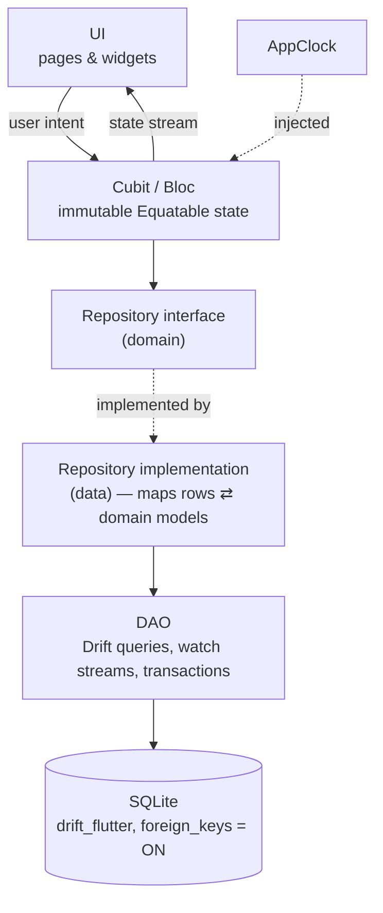
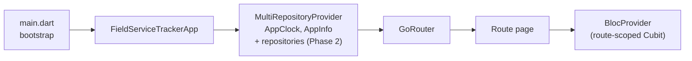

# Architecture

> Status: **Phase 1** — app shell, theme, routing and dependency wiring are
> implemented. Data layer and features are planned (marked *planned*).
> Rules are defined in [AGENTS.md](../AGENTS.md); this document explains them.

## Layers and data flow

- **Reactive updates (planned):** DAOs expose Drift `watch()` streams.
  Dashboard and Maintenance list subscribe to one *maintenance overview*
  stream (device + customer + latest record). Saving a maintenance record
  triggers the stream, so both screens update without manual refresh.
- **Status calculation (planned)** is a pure domain function applied to the
  stream data with today's date from `AppClock`.

## Dependency injection

Cubits are created per route and closed automatically when the route is
popped. Repositories and the database are app-wide singletons.

## Navigation

| Path | Screen | Navigator |
|---|---|---|
| `/dashboard` | Genel Bakış | tab 1 |
| `/customers` | Müşteriler | tab 2 |
| `/customers/new` | Yeni Müşteri | root |
| `/customers/:id` | Müşteri Detayı | root |
| `/customers/:id/edit` | Müşteriyi Düzenle | root |
| `/customers/:id/devices/new` | Yeni Cihaz | root |
| `/maintenance` | Bakımlar | tab 3 |
| `/settings` | Ayarlar | tab 4 |
| `/devices/:id` | Cihaz Detayı | root |
| `/devices/:id/edit` | Cihazı Düzenle | root |
| `/devices/:id/maintenance/new` | Yeni Bakım Kaydı | root |

- The four tabs use `StatefulShellRoute.indexedStack`; each tab keeps its
  scroll position and stack.
- Detail and form pages are pushed on the **root** navigator: they cover the
  bottom bar, and the Android back button pops them back to the tab.
- Unknown paths and malformed ids (`/customers/abc`) render `NotFoundPage`.

## Key decisions

| Decision | Reason |
|---|---|
| `material_ui` package instead of `flutter/material.dart` | Material was decoupled from the framework (Flutter 3.44+); `go_router` 18 uses it. One Material library avoids duplicate `ThemeData` types. |
| Cubit over Bloc | Screens have simple intent → state flows; no event transformers needed yet. |
| No use-case layer for CRUD | Avoids pass-through classes; domain services only for real rules. |
| Bundled Inter font | Offline-first: no runtime font download. |
| gen-l10n with a single `tr` ARB | Official tooling, compile-time checked strings, ready for more locales. |
| Date-only values for maintenance dates (planned) | Prevents timezone / DST day shifts. |
