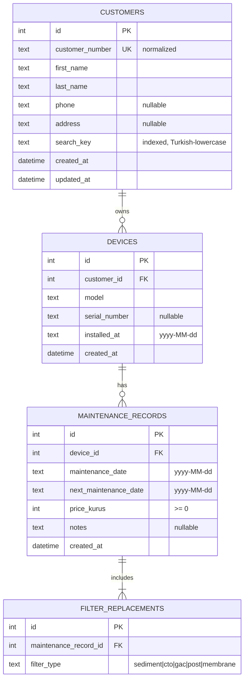

# Database

> Status: **planned — implemented in Phase 2.** This is the approved design.
> Integrity rules are defined in [AGENTS.md §7](../AGENTS.md#7-database-rules).

## Entity relationships

## Constraints and indexes

| Table | Constraint / index |
|---|---|
| customers | `UNIQUE(customer_number)`, `INDEX(search_key)`, non-empty names |
| devices | FK `customer_id` → customers `ON DELETE RESTRICT`, `INDEX(customer_id)` |
| maintenance_records | FK `device_id` `RESTRICT`, `CHECK(price_kurus >= 0)`, `CHECK(next_maintenance_date >= maintenance_date)`, `INDEX(device_id, maintenance_date)` |
| filter_replacements | FK `maintenance_record_id` `RESTRICT`, `UNIQUE(maintenance_record_id, filter_type)` |

## Rules

- **Customer number normalization:** trim, remove inner whitespace, uppercase.
  Stored normalized; uniqueness enforced by the index.
- **Search:** `search_key` = Turkish-aware lowercase of
  `"first last number"`, because SQLite `LIKE` is case-insensitive only for
  ASCII (`Ş`/`ş`, `İ`/`i`).
- **Dates:** date-only columns are stored as ISO `yyyy-MM-dd` text (sortable,
  no timezone); timestamps as UTC.
- **Latest maintenance:** `ORDER BY maintenance_date DESC, created_at DESC,
  id DESC` — deterministic on ties.
- **Maintenance records are immutable** in v1; completing a maintenance
  creates a new record. At least one filter per record.
- **Deleting a customer** deletes its filters → records → devices → customer
  explicitly in one transaction, after the user confirmed the counts.
- **Seed:** runs in `MigrationStrategy.onCreate` only (first install); dates
  are relative to the clock. "Reset demo data" wipes all tables and re-seeds
  in one transaction.
- **Migrations:** start at `schemaVersion = 1`; schema snapshots in
  `drift_schemas/` with migration tests for every bump.
