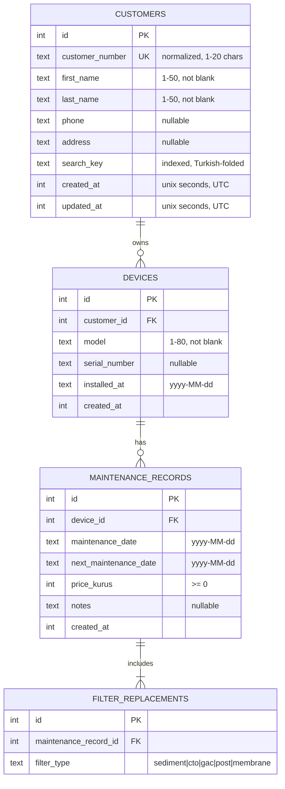

# Database

> Status: **implemented in Phase 2** (schema v1).
> Integrity rules are defined in [AGENTS.md §7](../AGENTS.md#7-database-rules).

Code: `lib/database/` (tables, DAOs, converters, seed, error mapping) and
`features/*/data/` (repository implementations).

## Entity relationships

## Constraints and indexes

| Table | Constraint / index |
|---|---|
| customers | `UNIQUE(customer_number)` (auto index), `idx_customers_search_key`, `CHECK(length(trim(first_name)) > 0)`, same for last name, length checks |
| devices | FK `customer_id` → customers `ON DELETE/UPDATE RESTRICT`, `idx_devices_customer_id`, non-blank model |
| maintenance_records | FK `device_id` `RESTRICT`, `CHECK(price_kurus >= 0)`, `CHECK(next_maintenance_date >= maintenance_date)`, `idx_maintenance_records_device_date (device_id, maintenance_date)` |
| filter_replacements | FK `maintenance_record_id` `RESTRICT`, `UNIQUE(maintenance_record_id, filter_type)` (also serves as the FK index) |

`PRAGMA foreign_keys = ON` is executed in `beforeOpen` on every connection;
`AppDependencies.open` verifies it at startup and fails fast otherwise.

## Rules

- **Customer number normalization:** remove all whitespace, uppercase
  (ASCII). Allowed: `A-Z 0-9 - _ / .`, max 20. Stored normalized; uniqueness
  enforced by the UNIQUE index, checked first by the repository for a clear
  error (`DuplicateCustomerNumberException`).
- **Search:** `search_key` = Turkish lowercase of `"first last number"` with
  `ç ğ ı ö ş ü` folded to ASCII. The query is folded the same way and split
  into words; every word must match (`LIKE '%word%'`, wildcards escaped).
  "seyma celik", "ŞEYMA" and "çelik şeyma" all find *Şeyma Çelik*.
- **Sorting:** customer lists are sorted in Dart with Turkish alphabet rules
  (`TurkishText.compare`) because SQLite sorts by byte value.
- **Dates:** date-only columns are ISO `yyyy-MM-dd` text (`CalendarDate`);
  timestamps are Drift `DateTime` (unix seconds) mapped to UTC in the domain.
- **Latest maintenance:** `ORDER BY maintenance_date DESC, created_at DESC,
  id DESC` — deterministic on ties (same day → saved later wins → higher id).
- **Maintenance records are immutable** in v1; at least one filter per record
  (domain rule). Record + filters are inserted in one transaction.
- **Filter values:** stored as `FilterType` names (`sediment`, `cto`, `gac`,
  `post`, `membrane`); Turkish display names ("CTO Karbon", "Post
  Mineral", …) live only in the localization files.
- **Deleting a customer:** `getDeletionImpact` returns the device / record
  counts for the confirmation dialog; `deleteCustomer` then deletes filters →
  records → devices → customer in **one transaction**. Any failure rolls back
  everything. Direct deletes of a parent with children fail (`RESTRICT`).
- **Deleting a device:** `DeviceRepository.getDeletionImpact` returns the
  maintenance record and filter replacement counts; `deleteDevice` deletes
  filters → records → device in **one transaction** (schema unchanged,
  foreign keys stay `RESTRICT`).
- **Errors:** `database_error_mapper.dart` converts `SqliteException`
  (also when wrapped in `DriftRemoteException` from the background isolate)
  into `ConstraintViolationException` / `DatabaseException` and logs details.

## Demo data

`DemoSeeder` (`lib/database/seed/demo_seeder.dart`):

- 20 fictional customers (`FST-0001` … `FST-0020`), phones `0500 000 00 xx`,
  invented street names; some without phone / address.
- 28 devices: customers own 0–3 devices (customer 20 owns none).
- 63 maintenance records (1–4 visits per serviced device, 6 months apart),
  210 filter replacements.
- The **next** maintenance date of each device is an offset from today:
  overdue (−60, −20, −5, −1), today (0), ≤ 7 days (2, 5, 7), ≤ 30 days
  (12, 20, 30), scheduled (31 … 160), and 3 devices never serviced.
- Deterministic: ids and values depend only on the clock date.

**When it runs:** in `beforeOpen` only if `details.wasCreated`, i.e. once
when the database file is created. Reopening the app never re-seeds; user
changes persist.

**Reset:** `DemoDataRepository.resetDemoData()` runs `deleteAllData()`
(children first, AUTOINCREMENT counters reset) and the seeder inside **one
transaction**. If seeding fails, the previous data stays intact.

## Migrations

- Current `schemaVersion`: **1**. Snapshot: `drift_schemas/app_database/drift_schema_v1.json`.
- Generated test helpers: `test/database/generated_schema/`.
- `test/database/app_database_test.dart` validates that the schema created by
  the app equals the exported v1 snapshot.

For a schema change:

1. Change the tables, bump `schemaVersion`.
2. `dart run drift_dev make-migrations` (exports the new snapshot, generates
   `stepByStep` helpers and a migration test scaffold).
3. Implement the step in `AppDatabase.migration.onUpgrade`.
4. `dart run drift_dev schema generate drift_schemas/app_database/ test/database/generated_schema/`
5. Add data-preserving migration tests, then run the full suite.
